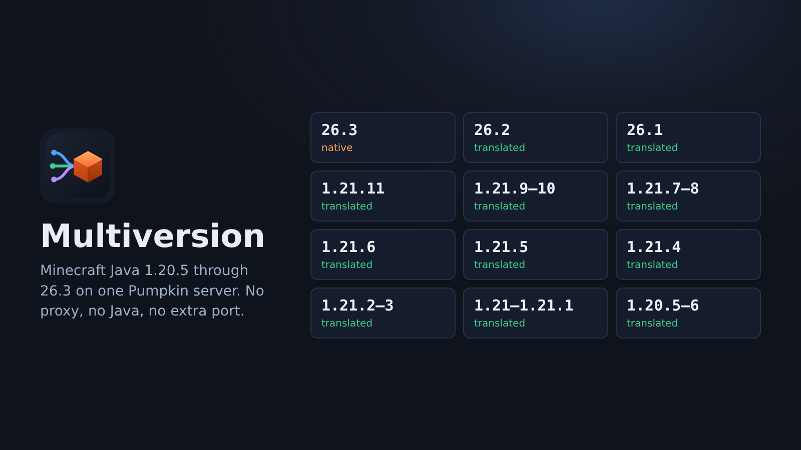

# multiversion: a Pumpkin plugin that lets other Minecraft versions join


`Multiversion.wasm` is a Pumpkin plugin. Once installed, players on other Minecraft Java versions
can join your 26.3 server: the plugin speaks their protocol version and translates every packet to
and from Pumpkin's. It needs no Java, no separate proxy process and no extra port to open. Everything
runs inside the server, as a WebAssembly plugin, configured by one `config.toml`.



| Client version | Status |
|---|---|
| 26.3 (protocol 777) | native, passed through untouched |
| 26.2 (protocol 776) | translated |
| 26.1 (protocol 775) | translated |
| 1.21.11 (protocol 774) | translated |
| 1.21.9 / 1.21.10 (protocol 773) | translated |
| 1.21.7 / 1.21.8 (protocol 772) | translated |
| 1.21.6 (protocol 771) | translated |
| 1.21.5 (protocol 770) | translated |
| 1.21.4 (protocol 769) | translated |
| 1.21.2 / 1.21.3 (protocol 768) | translated |
| 1.21 / 1.21.1 (protocol 767) | translated |
| 1.20.5 / 1.20.6 (protocol 766) | translated |
| 1.20.3 / 1.20.4 (protocol 765) | translated |
| 1.20.2 (protocol 764) | translated |
| 1.20 / 1.20.1 (protocol 763) | translated (the plugin goes through configuration for them) |
| 1.19.4 (protocol 762) | translated |
| 1.19.3 (protocol 761) | translated |
| 1.19.1 / 1.19.2 (protocol 760) | translated (chat is unsigned, see below) |
| 1.19 (protocol 759) | translated (chat is unsigned, see below) |

1.19 to 1.19.2 sign chat in a way newer versions cannot check, so those players' messages reach
the server unsigned and other players' chat reaches them as plain server messages (no reporting,
no "hide this player's messages"). They cannot chat on a server that enforces secure chat.

Content an older client doesn't have shows as its nearest equivalent: new mobs as similar old mobs,
new items and blocks as similar old ones. Translation has been checked with unit tests on hand-built
packets; report anything that disconnects a real client.

## How it works

Pumpkin only implements one protocol version and its plugin API has no hook for rewriting the
network protocol. What it does have is a WASI sandbox with real TCP sockets, so the plugin runs a
small proxy inside the server process:

```
player (26.2) ──► plugin listener :25565 ──► translator chain ──► Pumpkin 127.0.0.1:25566 (26.3)
                   │ handshake / status / login in the client's version
                   │ Mojang session check (online mode)
                   └ real UUID, skin and IP handed to Pumpkin via Velocity forwarding (HMAC-signed)
```

1. **Listener.** On load the plugin binds the public port (`[listen].address`) and Pumpkin itself
   is moved to a localhost-only port. The proxy loop runs in a scheduled task, so it never touches
   the tick thread.
2. **Login.** The plugin does the whole login with the client in the client's own version:
   encryption request, session check with Mojang (through WASI HTTP), compression. It then logs
   into Pumpkin as a 26.3 client and answers Pumpkin's `velocity:player_info` request with the
   verified profile, signed with the shared secret. Pumpkin's built-in Velocity forwarding verifies
   it, so players keep their real UUID, skin and IP and nobody can forge an identity.
3. **Translation.** Configuration and play packets go through a chain of per-version translators
   (26.3→26.2→26.1→…→1.21→1.20.5→1.20.3→1.20.2→1.20→1.19.4→1.19.3→1.19.1→1.19), each converting one version step. Registry id tables (blocks, items,
   entities, sounds, particles, data components, argument types) are generated from per-version
   registry mapping data; structural changes follow the vanilla protocol differences between steps.

## Install

Requirements: a Pumpkin 26.3 server (Pumpkin 0.2.2, commit `eda6944`, plugin API v0.1). Nothing else: no Java, no proxy, no extra process.

1. Copy `Multiversion.wasm` into your server's `plugins/` folder. The [Pumpkin Market](https://market.pumpkinmc.org/plugin/s7e5Nz2f) signs its copy, so Pumpkin loads it as verified; an unsigned build is on the [latest GitHub release](https://github.com/Xathr/Multiversion/releases/latest), or build it with `build.sh`.
2. Start the server and answer `y` when Pumpkin asks to approve the plugin's permissions. The
   plugin prints the lines to change in `pumpkin.toml`, for example:

   ```
   [Multiversion] SETUP NEEDED (one time): stop the server, open pumpkin.toml and change these 4 lines:
   [Multiversion]     [networking.java]             address = "127.0.0.1:25566"
   [Multiversion]     [networking.proxy]            enabled = true
   [Multiversion]     [networking.proxy.velocity]   enabled = true
   [Multiversion]     [networking.proxy.velocity]   secret = "..."
   ```

   The same list, with your own secret filled in, is saved as
   `plugins/data/multiversion/pumpkin-settings.txt`.
3. Stop the server, open `pumpkin.toml` (in the server folder) in a text editor and change those
   lines. Each one is already in the file, under the heading shown in `[brackets]`. Save it.
4. Start the server. The plugin checks Pumpkin's settings and prints
   `setup check passed`, or lists only the lines that are still wrong.

That is the whole setup, and it is the same on Linux and Windows. Players keep connecting to port
25565; keep 25566 closed in the firewall.

Why the edit is yours to make: Pumpkin lets a plugin write only inside its own data folder, so the
plugin cannot change `pumpkin.toml` itself. The first line moves Pumpkin to a local port so the
plugin can take over 25565; the other three make Pumpkin accept the signed player identity the
plugin forwards.

Two optional settings are listed in `pumpkin-settings.txt`: turning off Pumpkin's compression on
its local link to the plugin (saves CPU), and pre-approving the plugin's permissions so Pumpkin
stops asking.

`online_mode` in `pumpkin.toml` can stay `true`: with forwarding enabled, Pumpkin trusts the
plugin's signed profile instead of asking Mojang itself.

### Permissions

The plugin asks Pumpkin for `network.tcp` (listen + connect to Pumpkin), `http.outbound` (Mojang
session server, and the update check), `fs.read.data` and `fs.write.data` (its config and downloaded updates). Pumpkin asks on the console when the plugin first loads;
`pumpkin-settings.txt` shows the two lines that pre-approve them.

## Updates

When the server starts, the plugin asks the [Pumpkin Market](https://market.pumpkinmc.org/plugin/s7e5Nz2f)
for its latest version. If a newer one is out it says so in the console, and tells operators in
game a few seconds after they join.

| Command | Does |
|---|---|
| `/multiversion update` | Shows what the last check found |
| `/multiversion update check` | Asks the Market again |
| `/multiversion update download` | Saves the Market's signed `Multiversion.wasm` to `plugins/data/multiversion/update/Multiversion.wasm` |

The commands need operator level 3 or the `multiversion:update` permission. `check` and `download`
run between packets, so players never wait on the Market; the result is logged to the console.

Before saving a download, the plugin checks the Market's signature on it, the way Pumpkin does when
it loads a plugin, and that the file is the announced Multiversion version. A file that fails is not
saved. Pumpkin does not let a plugin write to `plugins/`, so the last step is yours: stop the server
and copy the file over `plugins/Multiversion.wasm`. With `[updates] download = true` the download
happens by itself at startup.

Set `[updates] check = false` to turn the check off. The requests are plain GETs of public Market
data, with the running plugin version; nothing about your server or players is sent.

## Security

The plugin is the server's front door, so it limits what a connection can cost before and after login:

- frames over 64 KiB are refused before login, and frames over 8 MiB after;
- a connection that has not finished logging in within `login_timeout_secs` is dropped;
- one address may have `max_logins_per_ip` connections still logging in, and open
  `max_connections_per_ip_per_10s` new connections per 10 seconds (server-list pings count);
- a connection that stops reading while more than 48 MiB waits to be sent to it is dropped;
- NBT data is limited in depth and in number of tags, and lists cannot claim more elements than the
  packet holds;
- a failed encryption handshake gets one answer whatever went wrong;
- names and versions reported by Bedrock clients are stripped of control characters before they are
  logged;
- the session check with Mojang times out instead of waiting for ever.

`cargo test` includes a test that throws hundreds of thousands of malformed packets at every
version's translators and fails on any panic, hang or oversized reply.

## Bedrock players in the console

Bedrock players connect to Pumpkin directly on its Bedrock port, not through this plugin, but the
plugin still logs them like Java players, with their Bedrock version and device:

```
[Multiversion] Steve [203.0.113.7:51234] (Bedrock 1.26.60, Android) uuid 0000... joined (native Bedrock connection)
```

## Configuration (`plugins/data/multiversion/config.toml`)

Console messages are coloured (player names, versions, joins in green, disconnects in yellow, errors
in red). Set `console_colors = false` at the top of the config for plain text. The web panel's
console always shows plain text.


```toml
[listen]
address = "0.0.0.0:25565"          # public port players use

[backend]
address = "127.0.0.1:25566"        # Pumpkin's networking.java.address
forwarding_secret = "..."          # = networking.proxy.velocity.secret
pumpkin_compression = false        # true keeps Pumpkin compressing its local link to the plugin
                                   # (costs CPU; players' connections are compressed either way)

[auth]
online_mode = true                 # verify players with Mojang
session_server = "https://sessionserver.mojang.com"
prevent_proxy_connections = false  # pass the client IP to Mojang

[status]
version_name = ""                  # server-list text; empty = the allowed range, e.g. "1.19-26.3"

[versions]
allow = ["*"]                      # default: every version the plugin can translate
deny = []                          # refused even if allowed above
# Entries: a version "1.21.4", a family "1.21.*", or a range "1.21.5-26.3" (either end optional).
# Patch releases that share a protocol count as one: 1.19.2 = 1.19.1, 1.20.1 = 1.20, 1.20.4 = 1.20.3, 1.20.6 = 1.20.5,
# 1.21.1 = 1.21, 1.21.3 = 1.21.2, 1.21.8 = 1.21.7, 1.21.10 = 1.21.9. Example: allow = ["1.21.*", "26.3"], deny = ["1.21"].
kick_unsupported_message = "This server supports Minecraft {versions}. You are on {client}."

[limits]
compression_threshold = 256        # packets to players above this size are compressed; -1 = off
max_connections = 200
login_timeout_secs = 30
max_logins_per_ip = 5              # connections one address may have still logging in; 0 = no limit
max_connections_per_ip_per_10s = 40  # new connections one address may open per 10 s; 0 = no limit

[updates]
check = true                       # ask the Pumpkin Market for the latest version at startup
notify_ops = true                  # tell operators in game when a newer version is out
download = false                   # download a newer, Market-signed Multiversion.wasm at startup

[messages]                         # what players see when they're disconnected
server_starting = "The server is starting up. Please try again in a moment."
auth_servers_down = "Authentication servers are down. Please try again later, sorry!"
invalid_session = "Invalid session (Try restarting your game and the launcher)"
username_mismatch = "Username mismatch"
internal_error = "Internal proxy error"
misconfigured = "Server misconfigured: see the server console."
protocol_error = "Protocol error: {error}"

[logging]                          # what goes in the console
joins = true
leaves = true
bedrock = true                     # Bedrock players' join/leave lines
errors = true
debug = false                      # every connection step; turn on when someone can't join
```

When the plugin starts it adds any setting your file does not list, at its default, and leaves
what is already there (comments included) as it is. Restart after editing.

Clients on versions without a translator see the server as incompatible in the server list and get
the kick message if they try anyway.

## What's translated for 26.2 clients

Done, following the vanilla 26.3→26.2 protocol changes:

- packet id remapping for play, configuration and serverbound packets (26.3 added
  `add_transient_block`, `post_effects`, `swing_animation`, `punch`, `spectator_action`);
- chunks (block state ids in indirect and direct palettes, 16→15 bit repacking), block updates,
  multi-block updates, block events, level events, light data (bit sets), block entities (pot
  sherds);
- registry data (removed registries dropped, trim materials, environment attributes, enchantment
  effects), tags (block/item/entity ids, renamed tag), commands (argument type ids and new parsers);
- items and every data component (ids inside remapped; 13 new components dropped or converted;
  swing animation split/merge; pot decorations; trims; instruments), in inventories, equipment,
  merchant offers, recipes and the recipe book, advancements, creative slots and hashed clicks;
- entities: types (cushion → falling block), spawn data, entity metadata (items, block states,
  particles, removed dye-colour type), movement packets (multi-step deltas → single delta),
  position sync, login/respawn game modes, arm swings/animations;
- particles (new leaf particles, speed/randomization change), sounds, explosions, maps,
  sign editor, chat filter masks, brewing stand data, player actions and teleport acks.

Known gaps: text components inside NBT (hover "show item") are not rewritten; 26.3-only blocks
and items show as their nearest 26.2 equivalent (poplar as birch, wool stairs as other stairs);
cushions appear as carpet blocks; new enchantment effect definitions are not shown.

## Build from source

```bash
./build.sh          # needs Rust; adds the wasm32-wasip2 target itself (.\build.ps1 on Windows)
cargo test --release   # native unit tests
```

### Layout

```
src/lib.rs            plugin entry (metadata, on_load, scheduled proxy task)
src/config.rs         config.toml
src/net/reactor.rs    poll-based reactor over WASI 0.2 TCP sockets
src/proto/            varint/strings, NBT, framing (zlib, AES-CFB8), version table
src/crypto.rs         RSA key pair, server hash, HMAC
src/auth.rs           Mojang hasJoined over WASI HTTP
src/update.rs         Pumpkin Market update check: versions, signature check (pure, unit-tested)
src/updater.rs        the update check and download as steps the reactor drives
src/http.rs           non-blocking HTTP GET over WASI HTTP
src/ratelimit.rs      new connections per address
src/conn.rs           per-connection state machine (handshake → status/login → play relay)
src/proxy.rs          reactor handler: sockets ↔ connections, timeouts
src/translate/        Translator trait + chain; one module per version step (v26_2/ = 26.3 ↔ 26.2, ...)
tools/gen_mappings.py regenerates the src/translate/data_*.rs id tables
tools/pack_names.py  packs their name lists into one shared pool (run after gen_mappings.py)
```

### Adding the next version step

1. Get per-version registry mapping files (`mappings/mapping-<version>.json` id lists and
   `mappings/diff/mapping-<new>to<old>.json` fallbacks) and run
   `tools/gen_mappings.py <dir> <new> <old> src/translate/data_<old>.rs`.
   Then run `tools/pack_names.py src/translate`, which stores the new name lists compactly.
2. Create `src/translate/v<old>/` after the pattern of the existing steps, covering every packet,
   registry and data component that changed between the two versions.
3. Register it in `translate::make_step` and add the version to `proto::version::KNOWN`.

## Speed

To see where translation time goes, record the packets a 26.3 client receives and replay them
through every version's translators:

```bash
MULTIVERSION_REPLAY=stream.bin cargo test --release replay -- --ignored --nocapture
```

(the file format is described in `src/translate/replay_bench.rs`). Translating a whole join and
45 seconds of play takes 5 to 80 ms depending on how many version steps the client is from 26.3.
In online mode most of the plugin's time goes on the connection encryption, which is why the
plugin has its own AES (`src/proto/aes.rs`).

## Testing

`cargo test` covers codecs, framing, crypto vectors and translator pieces. The full path was
exercised against a debug Pumpkin build with a scripted client (`status`, offline login, and an
online-mode login with RSA/AES against a stand-in session server) for both 26.3 and 26.2: login,
configuration, and the first few hundred play packets translate without errors. A real 26.2 client
has not been connected yet; see the main README for status.

## Sources

- Registry id tables (`src/translate/data_*.rs`) are generated from the per-version mapping
  files of the [ViaVersion Mappings](https://github.com/ViaVersion/Mappings) project.
- The version steps follow the same changes [ViaBackwards](https://github.com/ViaVersion/ViaBackwards)
  makes between each pair of versions, written again in Rust; both projects are GPL-3.0, as this
  one is.
- Packet layouts were checked against [minecraft-data](https://github.com/PrismarineJS/minecraft-data).

## Licence

GPL-3.0. See [LICENSE](LICENSE).
